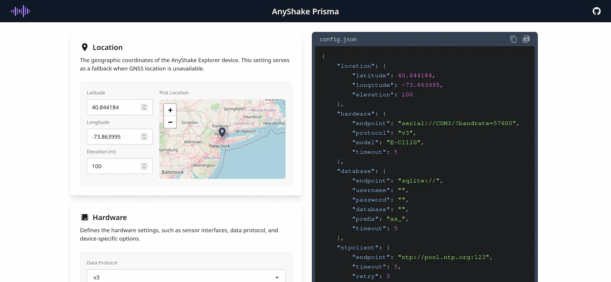

Observer reads its base configuration from JSON. **[AnyShake Prisma](https://anyshake.github.io/prisma)** provides a visual editor, live JSON preview, and download button. This reference describes fields read by Observer **4.9.0**; check generated output against it when using another Prisma version.



Download `config.json` and pass it with `observer -config /path/to/config.json`. File changes require restarting Observer. Station and optional service settings are stored in the database and managed through the web interface.

## Complete Example

This example uses an E-C111G over serial and persistent SQLite storage. Replace coordinates, connection, and paths for your station. Create the database's parent directory and make it writable by the running account.

```json
{
    "location": {
        "latitude": 25.033,
        "longitude": 121.5654,
        "elevation": 10
    },
    "hardware": {
        "endpoint": "serial:///dev/ttyUSB0?baudrate=57600",
        "protocol": "v3",
        "model": "E-C111G",
        "timeout": 5
    },
    "ntpclient": {
        "pool": [
            "ntp://time.mit.edu:123",
            "ntp://ntp1.lsu.edu:123",
            "ntp://ntp1.tamu.edu:123",
            "ntp://ntp1.cs.princeton.edu:123",
            "ntp://ntp.illinois.edu:123"
        ],
        "timeout": 5,
        "retry": 5
    },
    "database": {
        "endpoint": "sqlite://",
        "username": "",
        "password": "",
        "database": "/var/lib/observer/observer.db",
        "prefix": "as_",
        "timeout": 5
    },
    "server": {
        "listen": "127.0.0.1:8073",
        "debug": false,
        "cors": false
    },
    "logger": {
        "level": "info",
        "rotation": 5,
        "lifecycle": 3,
        "size": 0,
        "path": ""
    }
}
```

These are example values, not defaults applied to omitted fields. Provide all sections and required values explicitly. Relative database, log, custom metadata, and service paths resolve from the **working directory**, not the location of `config.json` or the executable.

## Location

| Field | Meaning |
| --- | --- |
| `location.latitude` | Fallback latitude in degrees, -90 to 90. |
| `location.longitude` | Fallback longitude in degrees, -180 to 180. |
| `location.elevation` | Fallback elevation in metres. |

GNSS position replaces fallback coordinates when available. Coordinates affect metadata and estimated seismic arrival times. General dashboard views round coordinates for non-administrators; exported metadata and integrations may include the actual location, so review them before sharing.

## Hardware

| Field | Meaning |
| --- | --- |
| `hardware.endpoint` | Required transport URL: `serial://` or `tcp://`. |
| `hardware.protocol` | `v1`, `v2`, or `v3`; `legacy` aliases `v1`. Match the firmware protocol. |
| `hardware.model` | Built-in metadata model or path to a custom metadata directory. |
| `hardware.timeout` | Read timeout in seconds; zero uses the transport's five-second default. |

Typical endpoints:

```text
serial:///dev/ttyUSB0?baudrate=57600
serial:///dev/serial/by-id/your-device?baudrate=57600
serial://COM3?baudrate=57600
tcp://192.168.1.50:30000
```

The serial baud rate is required and must match the device. Inspect `/dev/serial/by-id/` or kernel messages on Linux, or Device Manager on Windows. Only one application should open a serial device at a time. TCP transport connects through a serial-to-network bridge. GNSS is recommended for TCP because network latency affects software-derived timestamps.

Protocol v1 is the legacy three-channel format, v2 is used by E-D001, and v3 supports newer devices and up to eight channel slots. Check firmware rather than choosing solely by Observer version.

Built-in metadata currently includes **E-D001, E-C111G, E-C121G, and E-C131G**. Custom directories require `attributes.yaml`, `stationxml.tpl`, and `seiscomp.tpl`; follow the source [metadata library reference](https://github.com/anyshake/observer/blob/master/pkg/metadata/library/README.md). Use an instrument response matching your hardware.

## NTP Client

| Field | Meaning |
| --- | --- |
| `ntpclient.pool` | Array of NTP URLs, such as `ntp://ntp.nict.jp:123`. |
| `ntpclient.timeout` | Request timeout in seconds. |
| `ntpclient.retry` | Bounds additional batches using other endpoints after failures or disagreement. |

`ntpclient.endpoint` is deprecated since 4.2.0. Observer migrates it in memory only if `pool` is empty; update the file to use an array.

Observer maintains an internal time source without setting the host clock. GNSS-derived timestamps take priority when available. NTP synchronization validates replies, compares agreeing sources, and periodically refreshes source selection. Configure several independent reachable servers; three or more help reject an incorrect clock. Five healthy sources meet the routine preferred-source target. Proximity, network asymmetry, and server quality affect accuracy; ping latency alone is insufficient.

NTP needs outbound UDP, usually port 123. An initial required synchronization failure can prevent startup. One usable source is accepted for availability but cannot be cross-checked. Failed later measurements leave the existing clock correction in place. See the source [NTP client reference](https://github.com/anyshake/observer/blob/master/pkg/ntpclient/README.md) for polling and retries.

## Database

| Field | Meaning |
| --- | --- |
| `database.endpoint` | Engine URL; include host and port for remote engines. |
| `database.username` / `password` | Remote database credentials. |
| `database.database` | SQLite file path or remote database name. Required. |
| `database.prefix` | Table prefix; release example: `as_`. Keep stable after initialization. |
| `database.timeout` | Connection timeout in seconds. |

| Engine | Endpoint example | `database.database` example |
| --- | --- | --- |
| SQLite | `sqlite://` or `sqlite3://` | `/var/lib/observer/observer.db` |
| MySQL / MariaDB | `mysql://127.0.0.1:3306` or `mariadb://127.0.0.1:3306` | `observer` |
| PostgreSQL | `postgres://127.0.0.1:5432` or `postgresql://127.0.0.1:5432` | `observer` |
| SQL Server | `sqlserver://127.0.0.1:1433` or `mssql://127.0.0.1:1433` | `observer` |

Driver availability varies by build target. An unsupported engine error lists available engines. SQLite needs a writable file and parent directory for journal/WAL files. Remote databases must already exist, with permissions to create and migrate tables. Use a dedicated database account.

The release example's `/tmp/observer.db` is temporary; change it before deployment. Changing the database path, name, or table prefix can select an empty database and appear to reset users, settings, and history. Retention is configured in [Archiver Service](service-modules/archiver.md), independently of MiniSEED retention.

## Web Server

| Field | Meaning |
| --- | --- |
| `server.listen` | Required `host:port`, e.g. `127.0.0.1:8073`, `0.0.0.0:8073`, or `[::]:8073`. |
| `server.debug` | Enables GraphQL Playground at `/api/graphql` and pprof on `localhost:6060`. Keep disabled for normal operation. |
| `server.cors` | Allows cross-origin API requests when true. Authentication remains required. |

The executable serves HTTP. Use an HTTPS reverse proxy for public access or [Tailscale](service-modules/tailscale.md) for private remote access. A proxy must forward WebSocket upgrades for live waveforms and permit streaming notification responses. Bind to loopback if only a local proxy or embedded Tailscale needs access.

## Logger

| Field | Meaning |
| --- | --- |
| `logger.level` | `info`, `warn`, or `error`. Required. |
| `logger.rotation` | Maximum old files retained; zero removes the count limit. |
| `logger.lifecycle` | Maximum age of old files in **days**; zero removes the age limit. |
| `logger.size` | Maximum file size in **megabytes**; zero uses the logging library's 100 MB default. |
| `logger.path` | Output **file** path; empty disables file logging. Console output remains. |

Old logs are compressed. Count and age limits are independent; zero does not disable size-based rotation. For systemd/Docker, use `"path": ""` and read journal/container logs. For file logging in this version, create the parent directory and an empty writable regular log file first: current startup code attempts to create a directory at a nonexistent configured log path.

Restrict `config.json` access to the process account and administrators because it may contain database credentials.
