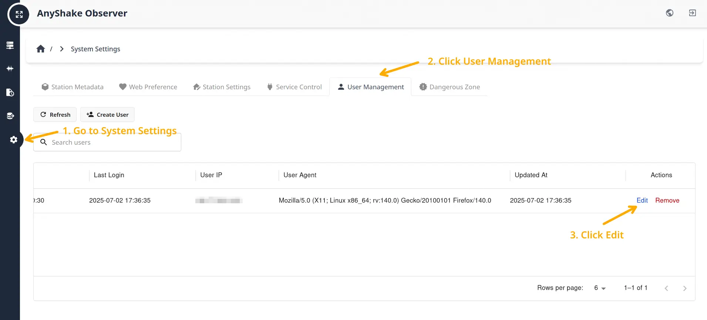
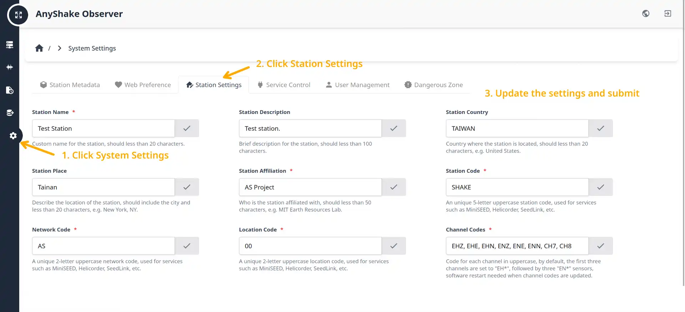

Observer needs a readable JSON configuration, a writable database, and a working hardware connection before the web interface becomes available. See [Installing Observer](installing-observer.md) and [Configuration Tool](configuration-tool.md) first. For upgrade methods and backup procedures, see [Upgrade and Backup](upgrade-and-backup.md).

## Command-line Arguments

| Argument | Purpose | Default |
| --- | --- | --- |
| `-version` | Print version and build information, then exit. | `false` |
| `-config PATH` | Read the base JSON configuration. | `./config.json` |

Both single and double hyphens are accepted. Relative paths resolve from the **process working directory**, independently of configuration file and executable locations.

```bash
observer -version
observer -config /usr/local/etc/observer/config.json
```

Version output includes the version, commit, build time, build channel, and target information. This documentation follows **4.9.0**.

On Windows, open PowerShell in the application directory:

```powershell
Set-Location 'C:\AnyShake Observer'
.\observer.exe -config .\config.json
```

For foreground operation, stop with **Ctrl+C** and wait for shutdown. Observer also handles SIGTERM on Unix-like systems. A second interrupt forces termination; avoid this while data is being written.

## First Login

Startup connects to the database, initializes its schema and settings, and opens the hardware transport. Time synchronization may take additional time. If hardware initialization fails, resolve the console or journal error before opening the web interface.

On a new database, Observer creates an administrator and prints its credentials:

| Field | Initial value |
| --- | --- |
| Username | `anyshake_admin` |
| Password | `Anyshake@12#$` |

Open `http://127.0.0.1:8073` on the Observer host, or use the host address if `server.listen` permits remote access. `0.0.0.0` specifies a binding, not a browser destination.

:::danger
Change default credentials immediately in **Settings → User Management** before allowing other users to connect.
:::

Passwords require 8–32 characters, at least one uppercase letter, and at least one special character. You can also rename the account. An administrator cannot remove their own administrator status through account editing.



## Station Settings

Configure station name, description, country, place, affiliation, station code, network code, location code, and channel codes in **Settings**. These identify waveforms and generated metadata. Network and location codes each require two characters; station codes accept one to five. Keep them consistent with downstream clients.

Default channel order: `EHZ`, `EHE`, `EHN`, `ENZ`, `ENE`, `ENN`, `CH7`, `CH8`; only channels supplied by the device are available. Restart Observer after changing channel codes, and restart affected services after changing station identifiers to refresh their cached settings. Re-export metadata when its inputs change.

The **FDSN Web Service** switch takes effect immediately. See [FDSN Web Services](fdsn-web-services.md) for access keys and examples.



Base settings in `config.json` require an application restart. Station and service settings are stored in the database; do not add service fields to `config.json`. See [Service Modules](service-modules/service-overview.md).

## Manage the systemd Service

For installations created by `get-observer.sh`:

```bash
sudo systemctl status observer.service
sudo journalctl -u observer.service -f
sudo systemctl restart observer.service
sudo systemctl stop observer.service
sudo systemctl enable observer.service
```

The service runs as `observer`, reads `/usr/local/etc/observer/config.json`, and works in `/var/lib/observer`. Relative MiniSEED and helicorder output therefore lives under `/var/lib/observer/service_data`. Console output goes to the journal. The generated unit grants existing `dialout`/`uucp` groups and the capability to bind UDP port 123.

For paths outside the installation's writable directories, update filesystem permissions and the unit's `ReadWritePaths`. After editing the unit, run `sudo systemctl daemon-reload` and restart it.

## Remove a Linux Installation

Stop and disable the service before removing its generated unit:

```bash
sudo systemctl disable --now observer.service
sudo rm /etc/systemd/system/observer.service
sudo systemctl daemon-reload
```

The executable directory, configuration, `/var/lib/observer`, and service account remain for backup or reinstallation. Remove those separately after deciding which recordings and settings to retain.
