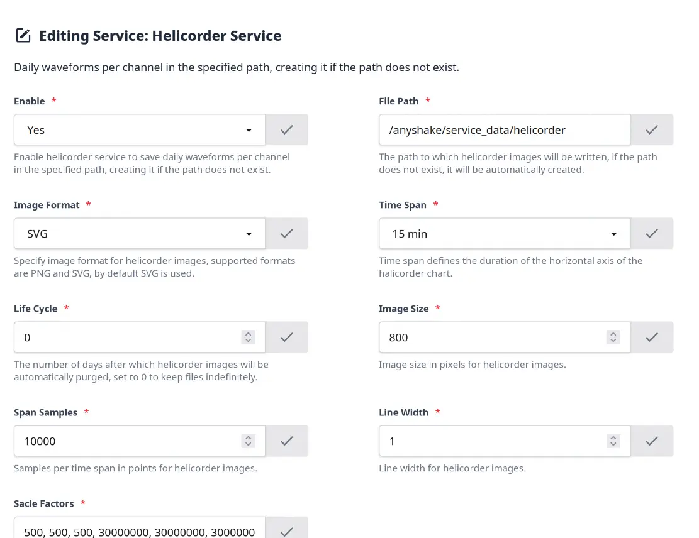

Observer 4.9.0 provides the following service modules. Defaults apply when settings are first initialized in a database; upgrading does not reset existing settings.

| Module | Enabled by default | Purpose / default listener |
| --- | --- | --- |
| [Archiver](archiver.md) | Yes | Store waveform history in the database. |
| [TCP Forwarder](tcp-forwarder.md) | Yes | Explorer-derived text stream, `localhost:30000`. |
| [SeedLink](seedlink.md) | Yes | SeedLink waveform streaming, `localhost:18000`. |
| [Metrics](metrics.md) | Yes | Send diagnostic telemetry every ten minutes. |
| [WatchCat](watchcat.md) | Always | Monitor hardware progress every 30 seconds. |
| [mDNS Discovery](discovery.md) | Yes | Advertise local services over multicast DNS. |
| [FRP Client](frp-client.md) | No | Publish the web interface through an FRP server. |
| [Helicorder](helicorder.md) | No | Render daily waveform plots from database records. |
| [MiniSEED](miniseed.md) | No | Write daily waveform files independently of Archiver. |
| [NTP Server](ntp-server.md) | No | Share Observer time, `0.0.0.0:123/udp`. |
| [QuakeSense](quakesense.md) | No | Detect triggers and publish MQTT notifications. |
| [Tailscale](tailscale.md) | No | Private access through Tailscale or Headscale. |
| [Winston](winston.md) | No | Winston/Earthworm waveform service, `localhost:16022`. |
| [Updater](updater.md) | No | Apply official software releases; official stable builds only. |

FDSN Station/DataSelect are configured in **Station Settings**, separately from this module list. See [FDSN Web Services](../fdsn-web-services.md).

## Configure and Operate

The homepage shows running status. Administrators manage modules in **Settings**, including configuration, start/stop/restart actions, timestamps, and restart counts.

Settings are stored in the database, not `config.json`. Save changes, then restart the affected service to reload its configuration. The enable switch controls startup availability; use Stop when a running module needs to stop, and enable a module before starting it. WatchCat has no persisted configuration switch.

Archiver is needed for retained history, helicorders, and older data requested through SeedLink, Winston, or FDSN DataSelect. MiniSEED files have their own retention and do not repopulate database history. File paths are relative to the process working directory unless absolute; for the Linux installer this directory is `/var/lib/observer`.

## Network Access

SeedLink, Winston, and TCP Forwarder bind to localhost by default. Change the listen host only when another machine must connect. These protocols do not use web-login authentication; restrict network access or forward them through a private VPN. Discovery advertises a port but does not change its binding or open a firewall.

Local acquisition, archiving, and local protocol servers can operate without continuous internet when their time source is available. Initial NTP synchronization, global event sources, Metrics, updates, remote MQTT brokers, FRP, and Tailscale coordination depend on their configured networks. An offline deployment must account for startup time synchronization as well as optional services.
