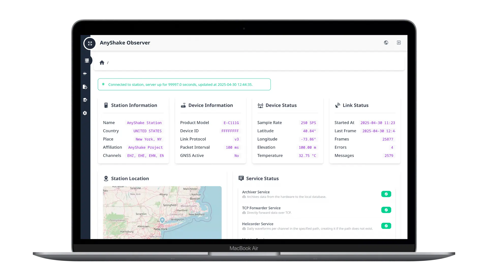
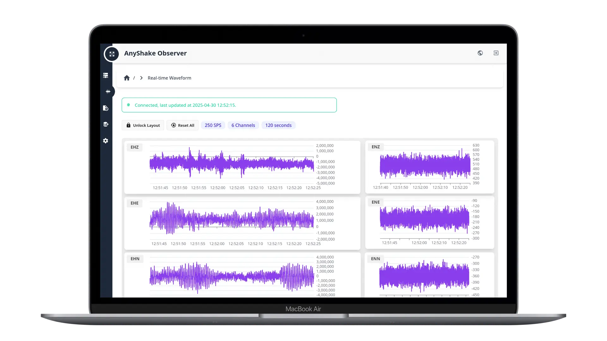
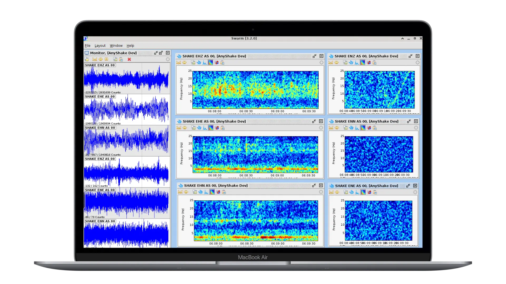
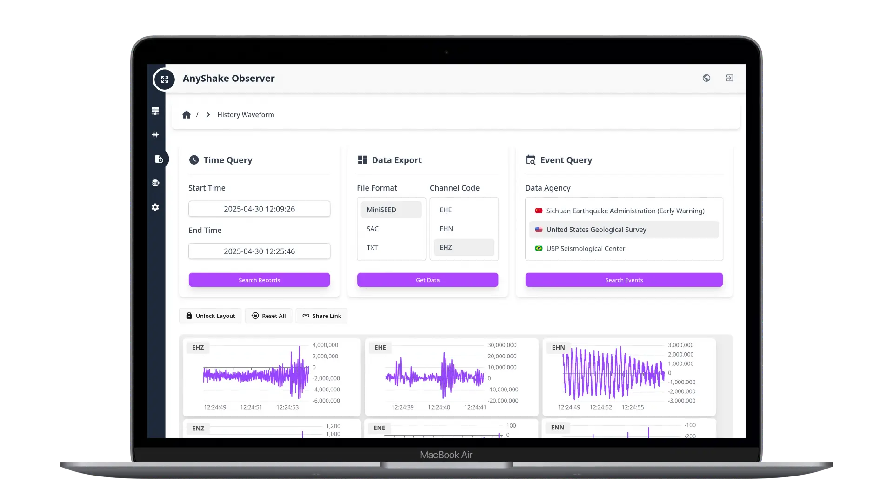
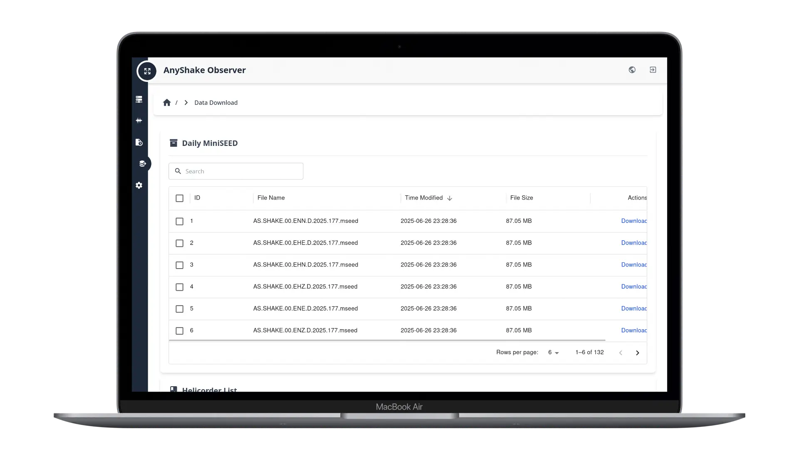
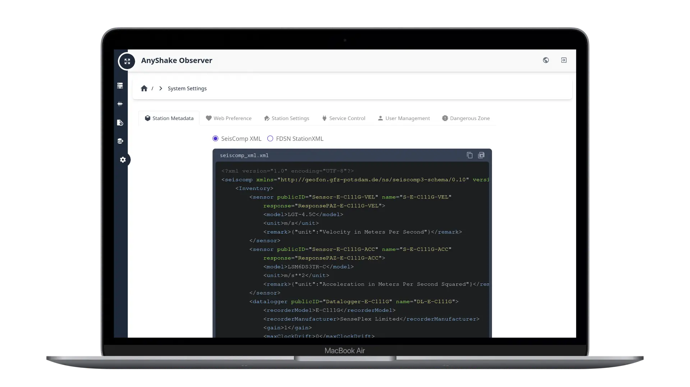
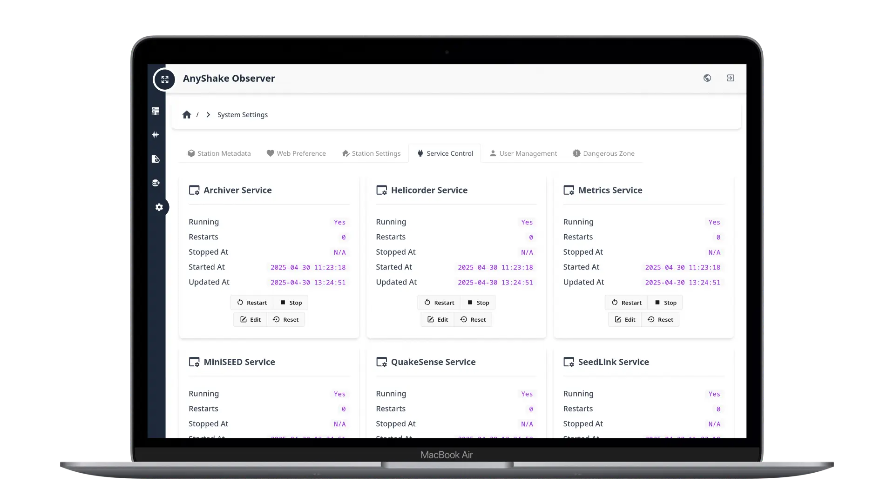
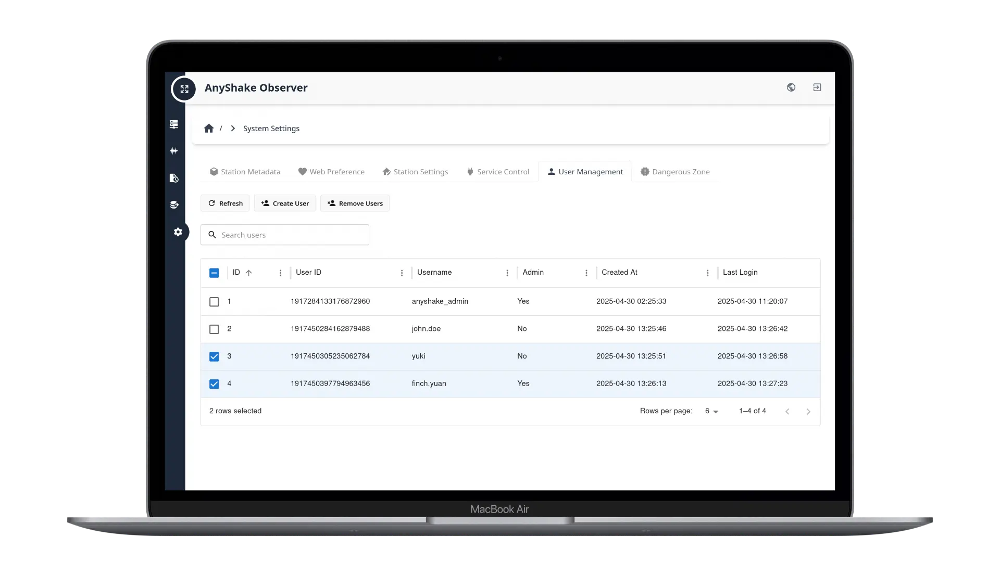

**AnyShake Observer** is the companion software for **AnyShake Explorer**, the world’s first fully open-source, high-precision seismic monitoring system. It is a cross-platform, web-based application designed to visualize, archive, and export seismic data in real time.

AnyShake Observer is written in **Go** and **TypeScript**, supporting a wide range of OS and CPU architectures, including embedded Linux. It offers real-time waveform display, event analysis, and database archiving, with a strong focus on professional usability and extensibility.

It connects to **AnyShake Explorer** over serial or a TCP bridge and exports **SAC** and **MiniSEED**, with **SeedLink**, **Winston**, and authenticated **FDSN Web Services** for networked clients.

This documentation follows **Observer 4.9.0**. See the [source changelog](https://github.com/anyshake/observer/blob/master/CHANGELOG.md) for release details. Screenshots may show earlier interface layouts.

## Features

- **Single-binary deployment** – fast, simple, and cross-platform
- **Web-based user interface** – no client installation required
- **Responsive design** – optimized for desktop, tablet, and mobile
- **Multi-language support** – auto-detects browser language
- **Real-time waveform display** – view live seismic data from your device
- **Multi-channel support** – visualize multiple sensors (e.g. geophone and accelerometer)
- **Historical waveform queries** – search by time or global seismic events
- **Sharable waveform links** – share analysis results with a single URL
- **Daily helicorder generation** – auto-generated visual timeline of activity
- **QuakeSense service** – built-in earthquake detection engine (STA/LTA and Z-Detect methods)
- **Data export** – save data as **MiniSEED**, **SAC**, **TXT**, or **WAV**
- **Streaming & forwarding** – supports **SeedLink** and **TCP** protocols
- **Flexible storage** – compatible with PostgreSQL, MariaDB/MySQL, SQL Server, and SQLite
- **Seamless SeisComP integration** – easily connect to professional seismic networks
- **FDSN Station and DataSelect** – query metadata and archived waveforms with managed access keys
- **Private remote access** – embedded Tailscale/Headscale with TCP and UDP forwarding
- **Local discovery** – mDNS advertisements for HTTP and running waveform services
- **Software maintenance** – manual official upgrades, optional automatic upgrades, and executable backup management
- **Display preferences** – light, dark, and system themes with remembered browser preferences

Start with [Installing Observer](installing-observer.md), configure the [base JSON settings](configuration-tool.md), then follow [Run Observer](run-observer.md). The [Service Modules overview](service-modules/service-overview.md) lists defaults and dependencies.

## Preview

Here are some screenshots showcasing the key features of **AnyShake Observer**.

### Home Dashboard

The Home Dashboard provides a concise overview of the station and device status, including current location, service module health, link connectivity, and real-time system statistics.

### Realtime Waveform

The real-time waveform view displays seismic data and the current sample rate from your AnyShake Explorer device in a web-based interface. It supports zooming, panning, and customizable channel layouts. Layout configurations are persistent and can be locked to prevent accidental changes.

### SeedLink Streaming

The AnyShake team independently developed a SeedLink protocol implementation in pure Go ([github.com/bclswl0827/slgo](https://github.com/bclswl0827/slgo)), enabling native SeedLink services without relying on RingServer or SeisComP. This allows seamless integration with tools like Swarm and ObsPy.

### Historical Data Query

Historical queries retrieve database waveforms for up to one hour, subject to resource limits, and require retained Archiver records. Global seismic agency data helps select arrival windows and requires network access. Export formats include MiniSEED, SAC, TXT, and WAV audio. WAV playback uses 30× speed for listening; use seismic formats for analysis.

### Data Download

The Data Download page allows users to access and download daily archived MiniSEED files and helicorder images directly from disk for extended archiving or offline analysis.

### Station Metadata

Station metadata, including instrument response, is available as SeisComP XML and FDSN StationXML. Built-in models include E-D001, E-C111G, E-C121G, and E-C131G; custom directories are supported. Metadata reflects current configuration and sample rate. Users can copy or download it, and authenticated clients can query [FDSN Web Services](fdsn-web-services.md).

### Service Control

A rich set of modular service modules are integrated, each running independently to ensure stability and flexibility. Users can enable, disable, or configure these modules directly through the web interface. The system also includes earthquake detection services using STA/LTA and Z-Detect algorithms (QuakeSense Service). Upon detecting seismic activity, it can push alerts in real time via MQTT protocol.

### User Management

The system supports both administrator and general user roles, making it adaptable for scenarios where multiple individuals manage and operate the site.

## Versioning

AnyShake Observer follows the [Semantic Versioning (SemVer)](https://semver.org) principles.

That means that with a version number x.y.z:

- When releasing critical bug fixes, we make a patch release by changing the z number (ex: 2.1.2 to 2.1.3).
- When releasing new features or non-critical fixes, we make a minor release by changing the y number (ex: 2.1.2 to 2.2.0).
- When releasing breaking changes, we make a major release by changing the x number (ex: 2.1.2 to 3.0.0).

Major releases can also contain new features, and any release can include bug fixes, minor releases are the most common type of release.
