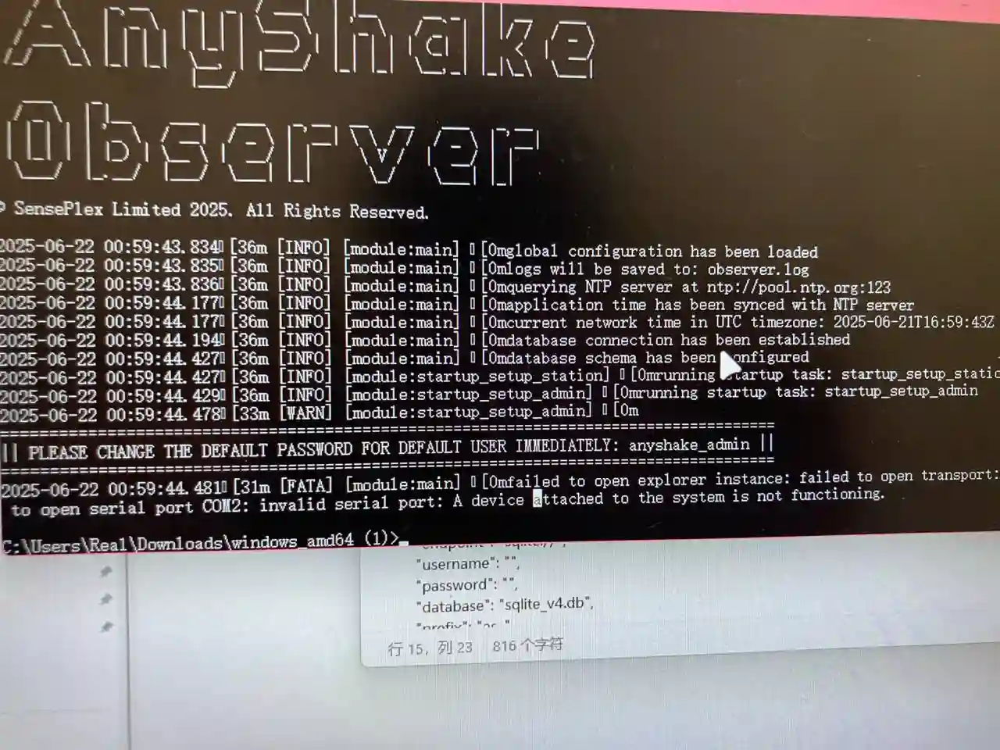

Start with the console output or `sudo journalctl -u observer.service -n 100 --no-pager`. Record the Observer version, platform, hardware model/protocol, and first relevant error. Separate configuration and operating-system permissions from hardware, network, and source-level failures before changing settings.

## Hardware Cannot Be Opened

Check the configured transport URL, device path, baud rate, firmware protocol, and power/cabling. On Linux, inspect `/dev/serial/by-id/` and `ls -l /dev/ttyUSB0` to identify the actual port and owning group. Only one process may open the serial device at a time.

For the Linux installer, the process account is `observer`. Its unit includes existing `dialout` and `uucp` groups. If a different device group is required, add it to the unit's `SupplementaryGroups`, reload systemd, and restart. Avoid changing serial permissions to world-writable.

On Windows, “A device attached to the system is not functioning” can indicate a USB-to-serial driver problem. Check Device Manager and the adapter manufacturer's driver compatibility. If the failure started after an update, roll back to a compatible driver; the appropriate version depends on the adapter and Windows release.



For TCP bridges, check reachability of the bridge address and port separately from Observer. A reachable port does not establish that the stream uses the expected Explorer protocol. Prefer GNSS timestamps when a network bridge adds variable latency.

## SQLite Is Read-only

SQLite needs write access to **both the database and its parent directory** for WAL/journal files. Check the account actually running Observer and any systemd or container restrictions.

For the installer layout, after stopping Observer, correct ownership only for the intended database files and directory. For example, if the main file is `/var/lib/observer/observer.db`:

```bash
sudo systemctl stop observer.service
sudo chown observer:observer /var/lib/observer /var/lib/observer/observer.db
sudo chmod 0750 /var/lib/observer
sudo chmod 0640 /var/lib/observer/observer.db
```

Also inspect any existing `observer.db-wal` and `observer.db-shm` files and correct their ownership if necessary. Do not remove an active WAL. Custom paths must be permitted by `ReadWritePaths` in the unit. On Windows, check directory ACLs and the database's Read-only attribute.

## Users or History Seem to Have Disappeared

Confirm the effective database path, table prefix, and process working directory. A relative path can point at a new empty database after switching to systemd or Docker. The release example's `/tmp/observer.db` is not persistent storage. Find and back up the original database before changing or replacing files.

History and FDSN DataSelect need database Archiver records. Enabling the MiniSEED writer alone does not provide database history. Allow for Archiver's ten-packet batch delay, check retention, and verify UTC query ranges and station codes.

## Web Page Opens but Login or Live Data Fails

Confirm the backend is running and listening on the configured interface and port. A cached page or reverse proxy response does not establish backend health. Check the browser's network panel and Observer logs for failed authentication, API, WebSocket, or notification requests.

If using a reverse proxy, preserve `/api` paths, WebSocket upgrades, and streaming responses. Use the correct protocol and port. Login requires a backend challenge and CAPTCHA; failed challenge or image requests can indicate an unavailable backend, proxy path errors, or rate limits. If cached assets mismatch after upgrading, reload the page and clear the site's stored data if necessary.

## A Service Cannot Start or a Remote Client Cannot Connect

Check that the module is enabled, save settings, and restart it. Inspect its logs for a bind failure or unavailable dependency. SeedLink, TCP Forwarder, and Winston listen on localhost by default. Discovery announcements do not override that binding. Check firewalls and network reachability separately.

UDP 123 may already belong to another NTP daemon or require a bind capability. QuakeSense needs its MQTT broker even when web notifications are the intended output. Helicorder needs database history and writable image/cache paths.

## NTP or Upgrade Requests Fail

NTP uses UDP and can be blocked even when HTTPS works. Check configured pool reachability and synchronization logs. Do not replace time sources or increase retries without first identifying the network or source-quality failure.

Built-in upgrades require an official non-prerelease build, eligible version metadata, reachable encrypted DNS and HTTPS endpoints, and a writable executable directory. A check failure differs from “no update available.” On self-built or Dockerfile builds, use external upgrades. See [Updater](service-modules/updater.md).

## File Logging Fails

`logger.path` must name a regular file, and `logger.size` is in megabytes. In this version, startup attempts to create a directory if the configured path does not exist. Pre-create the writable log file and its parent, or use `"path": ""` and collect console output with systemd/Docker.

## Queries Are Rejected for Resource Limits

The web API limits history requests to one hour and applies concurrency, response-size, and execution limits. Reduce the queried interval and avoid overlapping large queries. FDSN DataSelect limits the sum of selection durations to one hour and accepts at most 100 selections per request. Large query failures are not necessarily missing data; inspect the returned error.

For a reproducible source-level failure, report the first error and minimal steps on [GitHub Issues](https://github.com/anyshake/observer/issues). Include sanitized configuration and logs; remove passwords, access keys, and private station information.
