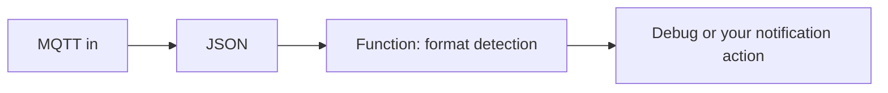

Use [QuakeSense](../anyshake-observer/service-modules/quakesense.md) to publish station detections to an MQTT broker and consume them in Node-RED. These are local trigger detections; noise or nearby activity can also activate the detector.

## Configure Observer

In **Settings → Service Modules → QuakeSense**:

1. Set a broker that both Observer and Node-RED can reach. Use your own broker and authentication for private data.
2. Set a station-specific topic, for example `anyshake/quakesense/station-a`, and a unique MQTT client ID.
3. Select an existing channel, typically `EHZ`, then configure its filter, STA/LTA windows, thresholds, and throttle interval.
4. Enable the module, save settings, and restart it. Inspect logs to confirm the MQTT connection and allow time for the detection window to fill.

The default public broker and randomly generated topic are convenient examples; copy the actual configured topic rather than assuming the example topic is in use.

## Build the Flow

Connect these nodes in the Node-RED editor, then deploy:



Configure **MQTT in** with your broker, credentials, and the exact Observer topic. Configure **JSON** to convert a JSON string to an object. Use this Function node:

```javascript
const event = msg.payload;
if (!event || !Number.isFinite(event.trigger_time)) {
    return null;
}
msg.payload = {
    station: `${event.network_code}.${event.station_code}.${event.location_code}`,
    channel: event.channel_code,
    time: new Date(event.trigger_time).toISOString(),
    method: event.trigger_method
};
return msg;
```

`trigger_time` is Unix **milliseconds**; do not multiply by 1000. Other payload fields include sample rate, station description, coordinates, trigger windows and thresholds, and filter settings. Avoid forwarding the entire payload to public destinations if coordinates should remain private.

## Verify and Tune

Use a controlled signal or a recorded station event to check that the expected topic reaches the Debug node. Compare trigger times with waveforms and adjust thresholds for background noise. The throttle interval suppresses closely spaced publications; it does not confirm that a trigger is an earthquake.

MQTT publications use **QoS 0** without retention. A disconnected subscriber will miss events, and delivery is not guaranteed. QuakeSense web notifications also depend on successful MQTT publication. If messages are missing, inspect broker connectivity, topic spelling, channel selection, detector warm-up, and the Observer logs before changing thresholds.
